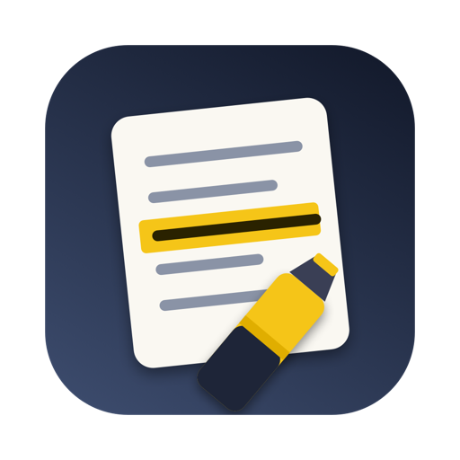
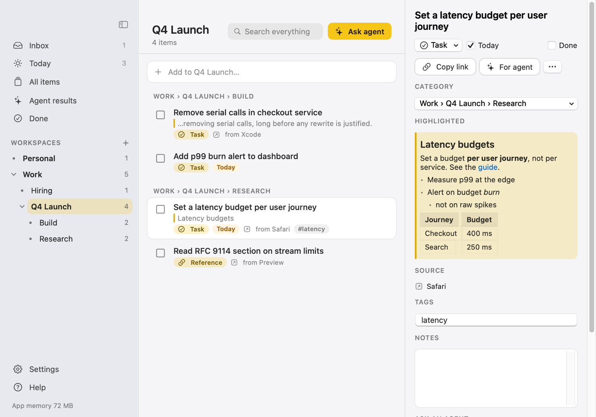
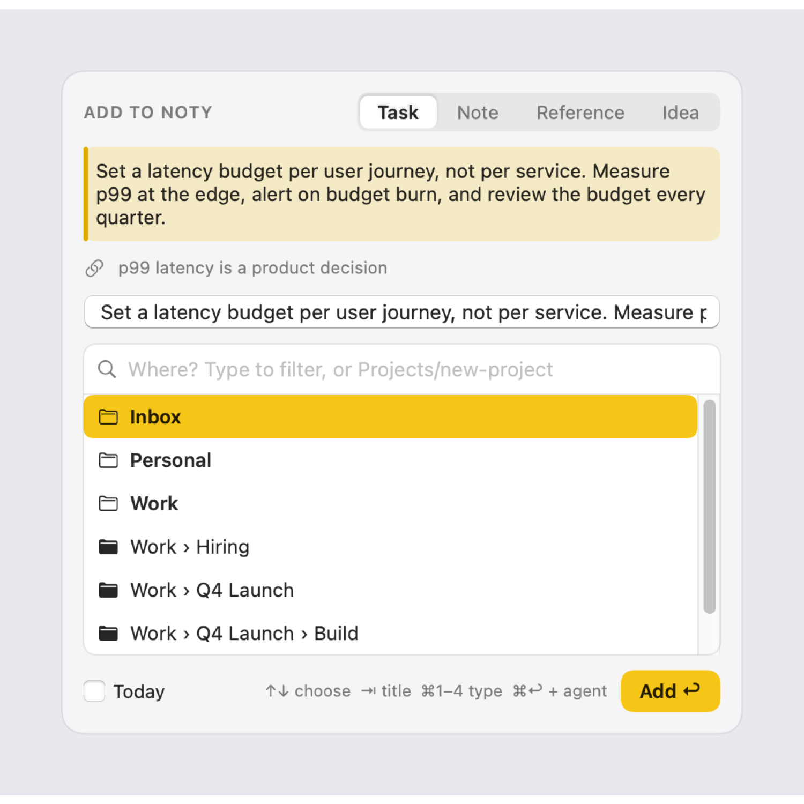
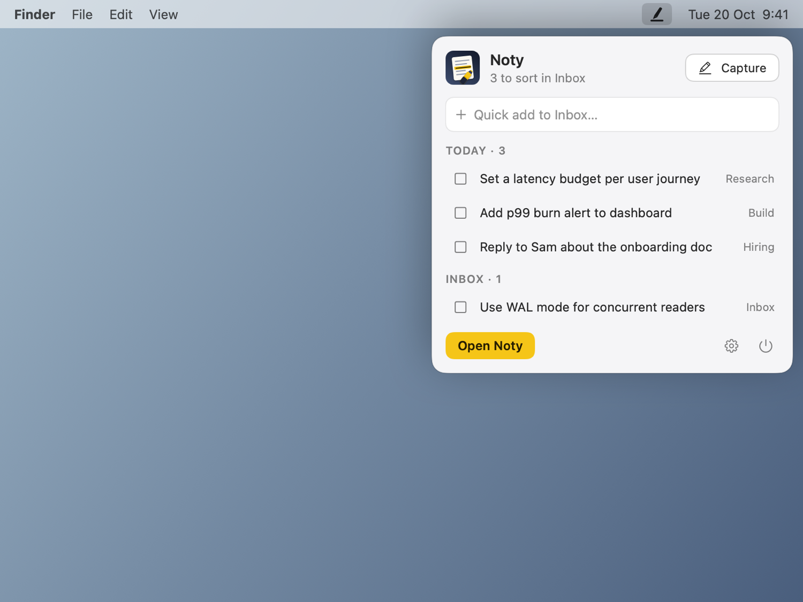
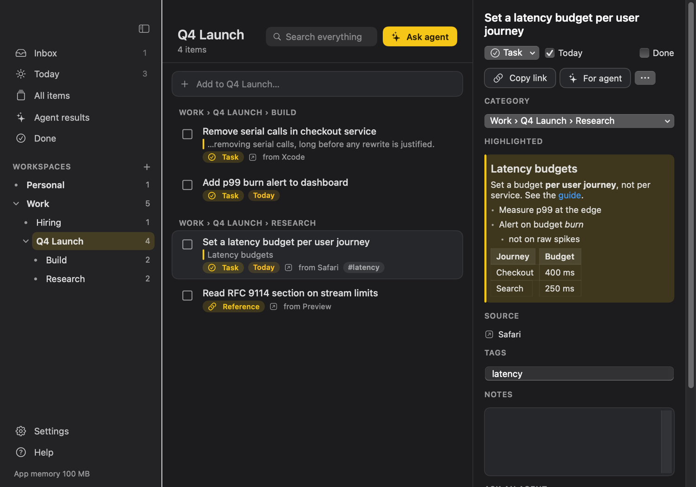
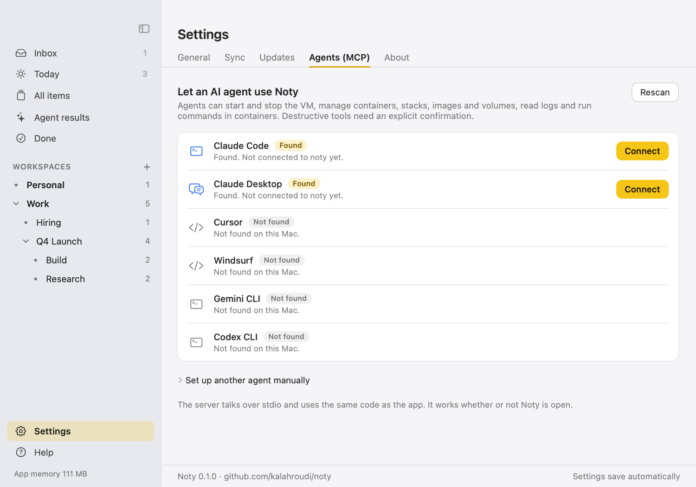

<p align="center"></p>

<h1 align="center">Noty</h1>

<p align="center"><b>Highlight text anywhere on your Mac. Press a shortcut. It lands in a categorised to-do tree your AI agents can work on.</b></p>

<p align="center">
  <a href="https://kalahroudi.github.io/noty/">Website</a> ·
  <a href="https://github.com/kalahroudi/noty/releases/latest">Download</a> ·
  <a href="#install-with-an-ai-agent">Install with an agent</a>
</p>

<p align="center"></p>

A light native macOS app (Swift, SwiftUI + AppKit, no dependencies): menu bar popover, Dock icon, manager window, MCP server for agents. Agents can review, break down, turn items into skills or Markdown files, and work through them.

<table>
  <tr>
    <td><br><sub>Capture panel: type, category, title.</sub></td>
    <td><br><sub>Menu bar popover: quick add, Today, Inbox.</sub></td>
  </tr>
  <tr>
    <td><br><sub>Light and dark.</sub></td>
    <td><br><sub>Connect agents in one click.</sub></td>
  </tr>
</table>

## Install with an AI agent

Paste this into an AI coding agent such as Claude Code. Noty needs nothing installed first:

```text
Install Noty on this Mac.
1. Run: curl -fsSL https://raw.githubusercontent.com/kalahroudi/noty/main/scripts/install.sh | bash
2. Noty opens in the menu bar. Tell me to press ⌥⌘N once and allow Accessibility when macOS asks.
3. Register its MCP server: claude mcp add noty --scope user -- /Applications/Noty.app/Contents/MacOS/noty-mcp
4. Call get_status and tell me what it reports.
Never delete my items without asking me first.
```

## How it works

- **Capture:** select text, a picture, a PDF or a Word paragraph anywhere (mouse or `⇧`+arrows), press `⌥⌘N` (changeable). A small panel appears next to the pointer: pick a type and a category with the arrow keys, press `↩`. `⌘↩` adds and opens "Ask agent". Also available as right-click → Services → Add to Noty. Formatting is kept: headings, bold/italic, lists, links and tables become Markdown, pictures and PDFs are saved with the item, and the original HTML is kept so you can paste it back with formatting. Needs the Accessibility permission for the shortcut.
- **Library:** workspaces and categories are folders; every item is a Markdown file with its highlighted text, notes, tags and source link. Open them in any editor.
- **Sync:** Settings → Sync moves the library to iCloud Drive or any folder (Dropbox, Syncthing, git). No server, no account. If two Macs edit the same item, the newer copy wins and the other is kept in `_history`.
- **Copy and link:** every item has Copy link (`noty://item/<id>`), Copy for agent (a ready-to-paste reference with the id the Noty tools understand), Copy as Markdown and Copy with formatting. Categories have links too.
- **Agents (MCP):** Settings → Agents connects Claude Code, Claude Desktop, Cursor and others in one click. Tools: `list_workspaces`, `list_items`, `get_item`, `search`, `add_item`, `update_item`, `move_item`, `complete_item`, `create_category`, `rename_category`, `propose_file`, `delete_item`. Files an agent wants to create wait under Agent results until you approve them.
- **Ask agent:** on any item or list, choose Review, Break into subtasks, Turn into a skill, Write a .md file or Process & fix. Noty builds the prompt and can run it in Claude Code in your Terminal, or you copy it into any agent.

## Build

```sh
swift build && swift test
scripts/bundle.sh              # dist/Noty.app
dist/Noty.app/Contents/MacOS/Noty --self-test
dist/Noty.app/Contents/MacOS/Noty --snapshot docs/shots   # screenshots with sample data
```

Release, signing and the updater follow the native-mac-app scaffold (`scripts/`, `.github/workflows/`).
